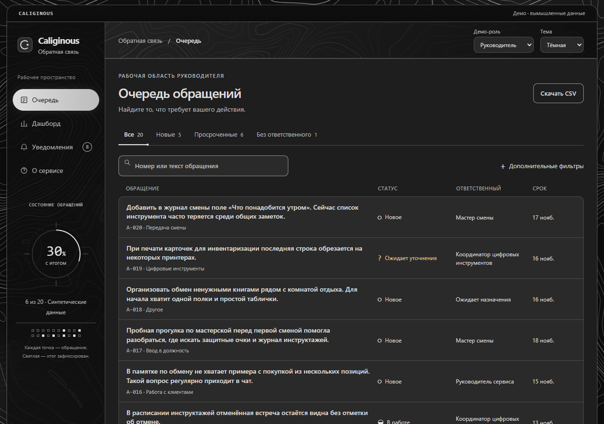
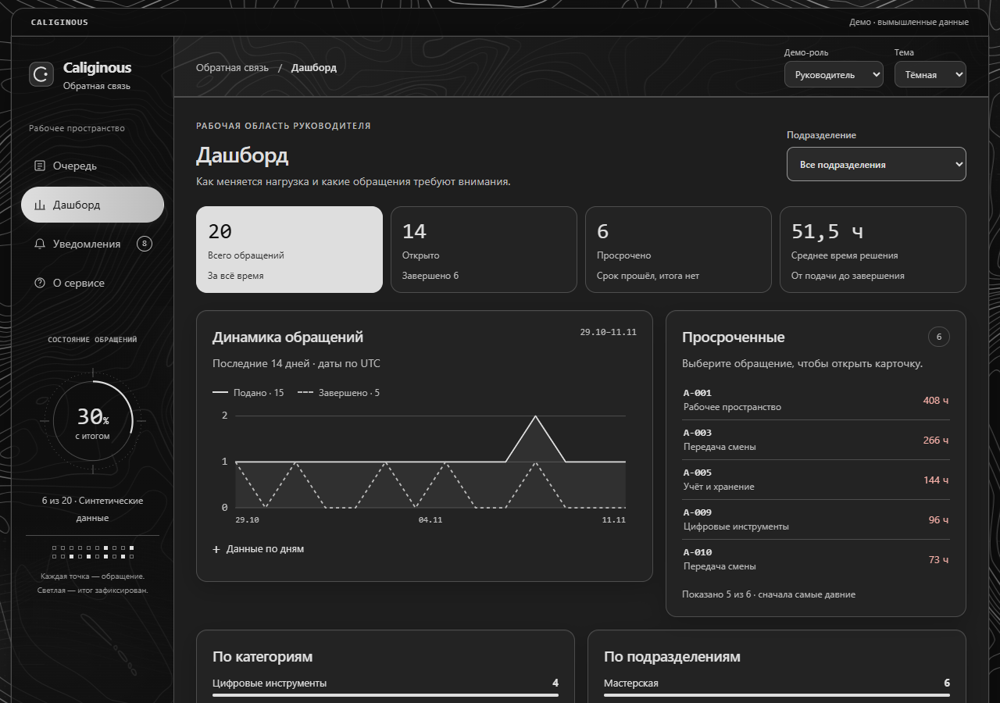
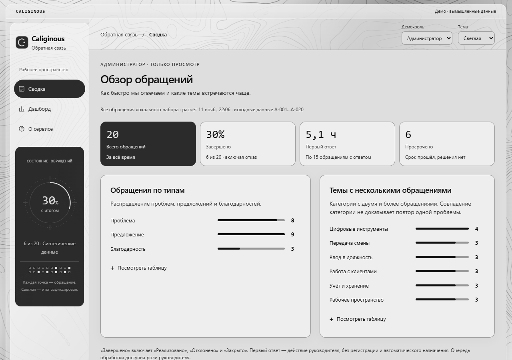

# Caliginous

Интерактивное дизайн-демо сервиса обратной связи сотрудников. [Открыть демо](https://ami-m1nzyi.github.io/caliginous-design/) · [Светлая сводка](https://ami-m1nzyi.github.io/caliginous-design/?theme=light#summary).

В шапке переключаются роль и тема. Начните с любого сценария.

| Роль | Что попробовать |
| --- | --- |
| Сотрудник | Создайте обращение, проверьте назначение и срок, ответьте на уточнение и прочитайте итог в карточке или уведомлениях. |
| Руководитель | Найдите обращение в очереди, назначьте ответственного или запросите уточнение. Зафиксируйте решение с объяснением, выгрузите отфильтрованную очередь в CSV. |
| Администратор | Посмотрите сводку и динамику за 14 дней. На дашборде можно выбрать подразделение и открыть таблицу данных графика. |

Для сквозного сценария откройте карточку после подачи обращения и переключайте роль прямо в ней. Чтобы увидеть уточнение сразу, откройте A-019 от роли сотрудника. В меню **Настройки демо** можно восстановить примеры и проверить состояния загрузки, пустой выборки и ошибки.

Все примеры вымышлены. Демороли показывают разные интерфейсы, а обращение, черновик и прочитанные уведомления сохраняются в текущей вкладке, включая перезагрузку. Приложение работает в браузере. Рабочая авторизация и сервер не подключены.

## Запуск локально

Скачайте репозиторий и откройте `index.html` в Chrome. Файлы сайта также можно раздавать любым статическим HTTP-сервером. Сборка и установка зависимостей не требуются.

## Дизайн

Тёмная тема использует графит, тонкие HUD-линии и пиксельный индикатор обращений. В светлой теме мягкие скругления и графитовые карточки выделяют основные действия и показатели. Рабочая область однотонная, а линии рельефа видны в оболочке сайта. При прокрутке шкалы заполняются по мере появления, а пунктир вокруг индикатора медленно вращается. Анимации можно выключить в **Настройках демо**. Демо учитывает системную настройку уменьшения движения.

